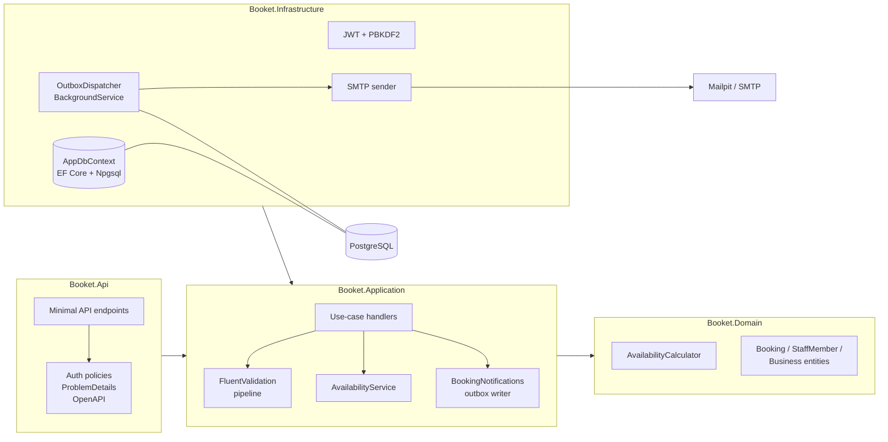
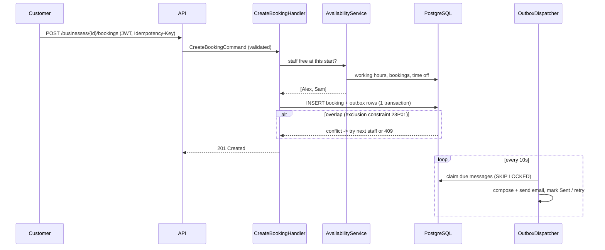

# Booket

**Appointment booking API for small businesses: barbers, clinics, studios, tutors.**
Customers find open slots, then book, reschedule and cancel. Businesses manage services, staff
schedules and time off. Reminders go out automatically.

Built with **.NET 10**, **ASP.NET Core Minimal APIs**, **EF Core** and **PostgreSQL**, following Clean
Architecture. It is production-minded: double booking is impossible at the database level, notifications go
through a transactional outbox, telemetry is end-to-end, and the integration tests run against a real
PostgreSQL in Docker.

[](https://github.com/BrunoDenisov/booket/actions/workflows/ci.yml)

---

## Highlights

| | |
|---|---|
| **Availability engine** | Pure, DST-aware slot calculation from weekly working hours (split shifts), time off, existing bookings, service duration + buffer, lead time and booking horizon. |
| **No double booking, ever** | A PostgreSQL `EXCLUDE USING gist` constraint on `(staff_id, tstzrange(start, blocked_until))` guarantees it across any number of API instances. A test fires 10 parallel requests and asserts exactly one wins. [ADR 0002](docs/adr/0002-double-booking-exclusion-constraint.md) |
| **Reliable reminders** | Transactional outbox and a `BackgroundService` dispatcher using `FOR UPDATE SKIP LOCKED` leases, with exponential-backoff retries. Reminders are re-planned on reschedule and cancelled on cancellation. [ADR 0003](docs/adr/0003-outbox-reminders.md) |
| **Multi-tenant security** | JWT with roles (`Customer`, `Staff`, `Owner`, `Admin`) plus a tenant-aware policy that checks the `business_id` claim against the route. Other tenants' resources return 404, so their ids are not revealed. |
| **Auth done properly** | Short-lived access tokens, rotating refresh tokens stored hashed, and reuse detection that revokes the whole session. PBKDF2 password hashing. Rate-limited auth endpoints. |
| **Idempotent booking** | `Idempotency-Key` header: retries return the original booking, and reusing a key with a different payload is rejected. |
| **Consistent errors** | Every failure is RFC 9457 `application/problem+json` with a machine-readable `code` and a `traceId`. |
| **Observability** | Serilog structured JSON logs and OpenTelemetry traces + metrics (ASP.NET Core, HttpClient, Npgsql, custom booking/notification counters) exported over OTLP to the Aspire Dashboard. |
| **Testable time** | `TimeProvider` is injected everywhere, including JWT lifetime validation, so tests can move the clock to "2 hours before the appointment". |

## Quick start

Requirements: Docker. The .NET 10 SDK is needed only to run the tests or the API outside Docker.

```bash
docker compose up --build
```

| What | Where |
|---|---|
| Swagger UI | http://localhost:8080/swagger |
| OpenAPI document | http://localhost:8080/openapi/v1.json |
| Mailpit (catches all outgoing email) | http://localhost:8025 |
| Aspire Dashboard (traces, metrics, logs) | http://localhost:18888 |
| Health | http://localhost:8080/health/ready |

A demo business, **Demo Barbershop** (slug `demo-barbershop`, `Europe/London`), is seeded with two
staff members, three services and weekly hours. All demo users share the password `Passw0rd!`:

| Role | Email |
|---|---|
| Customer | `customer@demo.booket.local` |
| Owner | `owner@demo.booket.local` |
| Staff | `alex@demo.booket.local` |
| Admin | `admin@booket.local` |

[`src/Booket.Api/Booket.Api.http`](src/Booket.Api/Booket.Api.http) walks through the whole flow (log in, find
slots, book, reschedule, cancel) from VS Code, Rider or Visual Studio.

### Try it with curl

```bash
API=http://localhost:8080/api/v1
BIZ=$(curl -s $API/businesses/demo-barbershop | jq -r .id)
SVC=$(curl -s $API/businesses/$BIZ/services | jq -r '.[0].id')
TOKEN=$(curl -s -X POST $API/auth/login -H 'Content-Type: application/json' \
  -d '{"email":"customer@demo.booket.local","password":"Passw0rd!"}' | jq -r .accessToken)

# Open slots for the next week (business-local dates)
curl -s "$API/businesses/$BIZ/availability?serviceId=$SVC&from=$(date +%F)&to=$(date -d '+6 days' +%F)" | jq '.days[] | {date, first: .slots[0].start}'

# Book the first one with any available staff member
START=$(curl -s "$API/businesses/$BIZ/availability?serviceId=$SVC&from=$(date -d '+1 day' +%F)&to=$(date -d '+7 days' +%F)" | jq -r '[.days[].slots[]][0].start')
curl -s -X POST $API/businesses/$BIZ/bookings -H "Authorization: Bearer $TOKEN" \
  -H 'Content-Type: application/json' -H "Idempotency-Key: $(uuidgen)" \
  -d "{\"serviceId\":\"$SVC\",\"start\":\"$START\"}" | jq
```

Then open Mailpit to see the confirmation email, and the Aspire Dashboard to see the request trace down to the SQL.

## Architecture



The dependency rule points inwards. The domain has **no package references**, so the scheduling rules are
plain C# tested without mocks. See [ADR 0001](docs/adr/0001-clean-architecture.md).

### How a booking request flows



### The availability algorithm

For each staff member who performs the service, and each business-local date in the range:

1. Project the weekly windows for that weekday (several per day for split shifts) and convert them to UTC
   with the business's IANA time zone. A start falling in a spring-forward gap moves to the first valid
   instant. A fall-back overlap keeps the extra hour.
2. Walk each window on the policy's grid (e.g. every 15 min from the window start).
3. Keep a start when:
   - the **service** ends within the window (the buffer may run past closing);
   - `start >= now + minLeadTime` and `start <= now + maxAdvanceDays`;
   - `[start, start + duration + buffer)` overlaps **no** booking (with its buffer) and no time off.

Booking and rescheduling run the **same** code for the requested start, so a slot is offered only if
it can actually be booked.

## API overview

All routes are under `/api/v1`. Full schemas are in Swagger.

| Area | Endpoints | Who |
|---|---|---|
| Auth | `POST /auth/register`, `POST /auth/register-business`, `POST /auth/login`, `POST /auth/refresh`, `POST /auth/logout`, `GET /auth/me` | anyone (rate limited) |
| Businesses | `GET /businesses?search=`, `GET /businesses/{id-or-slug}`, `PUT /businesses/{id}` | public / owner |
| Services | `GET, POST /businesses/{id}/services`, `PUT, DELETE …/services/{serviceId}` | public / owner |
| Staff | `GET, POST /businesses/{id}/staff`, `GET, PUT …/staff/{staffId}`, `PUT …/working-hours`, `PUT …/services` | public / owner |
| Time off | `GET, POST …/staff/{staffId}/time-off`, `DELETE …/time-off/{timeOffId}` | staff / owner |
| **Availability** | `GET /businesses/{id}/availability?serviceId&from&to&staffId` | public |
| **Bookings** | `POST /businesses/{id}/bookings`, `GET /bookings/me`, `GET /bookings/{id}`, `POST /bookings/{id}/cancel`, `POST /bookings/{id}/reschedule` | customer (own) / business |
| Calendar | `GET /businesses/{id}/bookings?from&to&staffId&status`, `POST /bookings/{id}/complete`, `POST /bookings/{id}/no-show` | staff / owner |
| Ops | `GET /health/live`, `GET /health/ready` | public |

Example error:

```json
{
  "type": "https://tools.ietf.org/html/rfc9110#section-15.5.10",
  "title": "Conflict",
  "status": 409,
  "detail": "The requested time slot is no longer available.",
  "instance": "POST /api/v1/businesses/0193.../bookings",
  "code": "booking.slot_unavailable",
  "traceId": "6ecd3c48b6de82ef7a86cb08e16a9f13"
}
```

| Status | Meaning |
|---|---|
| 400 | Validation failed (`errors` holds the messages for each field) or the JSON is malformed |
| 401 / 403 | Not authenticated / not allowed |
| 404 | Not found, or not yours |
| 409 | Slot taken, concurrent update, or a duplicate email/slug |
| 422 | Business rule, e.g. `booking.cancellation_cutoff` or `booking.idempotency_key_reused` |
| 429 | Rate limited |

## Running locally without Docker for the API

```bash
docker compose up -d postgres mailpit aspire-dashboard
dotnet run --project src/Booket.Api        # http://localhost:5080/swagger
```

`appsettings.Development.json` points at the Compose PostgreSQL, applies migrations and seeds demo data.

## Tests

```bash
dotnet test                      # everything (Docker must be running for the integration tests)
dotnet test tests/Booket.Domain.Tests
```

| Project | What it covers |
|---|---|
| `Booket.Domain.Tests` | Availability engine: grid, buffers, split shifts, lead time, horizon, DST spring-forward and fall-back. Booking state machine. Outbox backoff. |
| `Booket.Application.Tests` | Validators (IANA time zones, slugs, password policy, ranges) and the validation/tracing pipeline. |
| `Booket.Api.IntegrationTests` | The real API (`WebApplicationFactory`) against **PostgreSQL in Testcontainers**, reset between tests with **Respawn**, using a controllable clock and a capturing email sender. Covers booking, the concurrency race, cutoff, reschedule, idempotency, reminder timing and retries, refresh token reuse, tenant isolation, validation, OpenAPI and health. |

## Configuration

| Key | Default | Notes |
|---|---|---|
| `ConnectionStrings:Booket` | – | PostgreSQL connection string |
| `Jwt:SigningKey` | – | **Required**, ≥ 32 chars. Use env vars or user-secrets |
| `Jwt:AccessTokenLifetime` / `RefreshTokenLifetime` | `00:15:00` / `14.00:00:00` | |
| `Database:MigrateOnStartup` / `SeedDemoData` | `false` | Enabled in Development and Compose |
| `Notifications:ReminderOffsets` | `["1.00:00:00", "02:00:00"]` | How long before the appointment each reminder is sent |
| `Outbox:PollInterval` / `BatchSize` / `MaxAttempts` / `RetryBaseDelay` | `10s` / `20` / `5` / `1m` | |
| `Outbox:DispatcherEnabled` | `true` | Disable to run dispatching on dedicated instances only |
| `Smtp:*` | Mailpit on `localhost:1025` | |
| `RateLimiting:AuthPermitsPerMinute` | `20` | Per client IP |
| `OTEL_EXPORTER_OTLP_ENDPOINT` | – | Enables OTLP export of traces, metrics and logs |

Migrations live in `src/Booket.Infrastructure/Persistence/Migrations`. To add one:

```bash
dotnet tool restore
dotnet ef migrations add <Name> --project src/Booket.Infrastructure --startup-project src/Booket.Api --output-dir Persistence/Migrations
```

For production, prefer running a migration bundle (`dotnet ef migrations bundle`) as a deployment step
instead of `MigrateOnStartup`.

## Project layout

```
src/
  Booket.Domain/          entities, value objects, AvailabilityCalculator, Result/Error
  Booket.Application/     Features/<Area>/ requests + validators + handlers, ports, telemetry
  Booket.Infrastructure/  EF Core (configurations, migrations), JWT, outbox processor + dispatcher, SMTP
  Booket.Api/             endpoints, authorization, ProblemDetails, OpenAPI, Serilog/OpenTelemetry
tests/
  Booket.Domain.Tests/  Booket.Application.Tests/  Booket.Api.IntegrationTests/
docs/adr/                 architecture decision records
```

## Possible next steps

- Customer-facing time zone preference and iCal attachments in emails
- Per-service staff pricing, resources (rooms/chairs) as a second constraint dimension
- Webhooks/SMS channels as additional outbox consumers
- Waitlist: offer freed slots to waiting customers when a booking is cancelled
